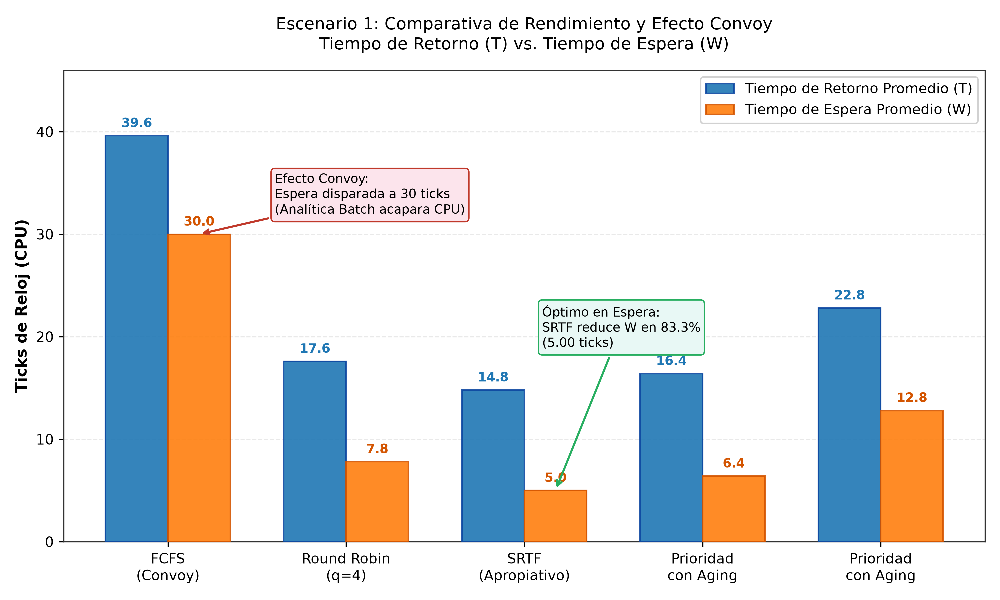
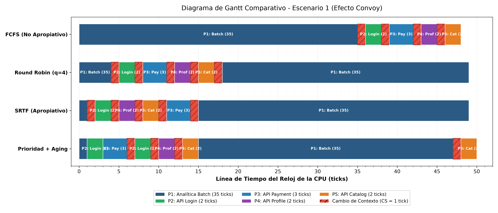
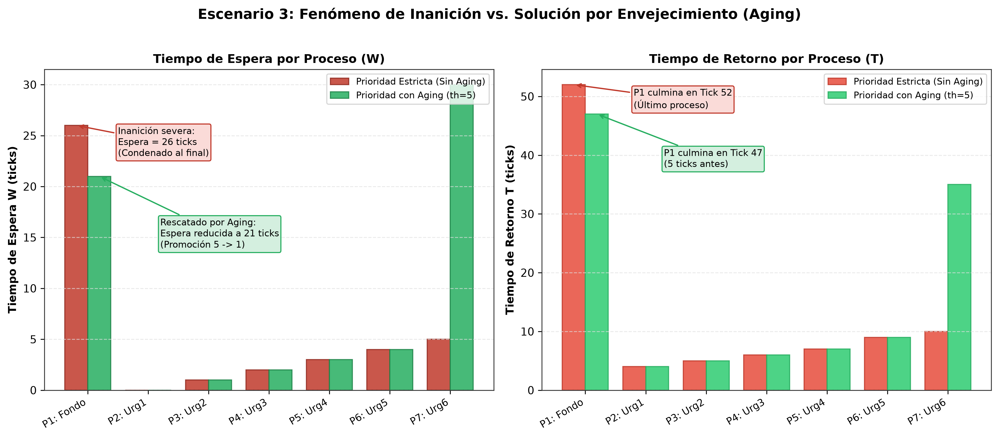
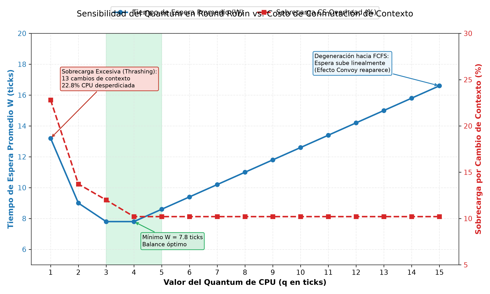

<!-- SLIDE 1 -->
# Simulación y Análisis Cuantitativo de Políticas de Planificación de CPU
## Modelado del Ciclo de Vida de Procesos, Desalojo, Inanición y Sobrecarga de Kernel

**Asignatura:** Sistemas Operativos  
**Opción Seleccionada:** Opción 1 — Gestión de Procesos y Planificación de CPU  
**Tecnología del Simulador:** C++17 Puro (Arquitectura Modular y Determinista)  
**Herramientas de Análisis:** Python 3 (Matplotlib, Pandas, Seaborn)  

---

### Integrantes del Equipo de Trabajo:
* **Desarrollador 1:** Arquitectura del Simulador, PCB, Dispatcher y Motor de Métricas
* **Desarrollador 2:** Módulo Gráfico de Métricas, Diagramas de Gantt y Diapositivas

<div class="notes">
<b>Guía del Orador (Minuto 0:00 - 1:30):</b><br>
"Buenos días profesor. Hoy presentamos nuestro proyecto de Sistemas Operativos enfocado en la gestión de procesos y la planificación de CPU. Hemos desarrollado desde cero un simulador determinista en C++17 modular que reproduce el comportamiento de un kernel real, incluyendo el Bloque de Control de Proceso (PCB), transiciones canónicas de estado, colas de E/S desacopladas, penalizaciones explícitas por cambio de contexto y mecanismos dinámicos anti-inanición."
</div>

---

<!-- SLIDE 2 -->
# 1. Planteamiento del Problema en Sistemas Operativos Reales

En entornos modernos de backend, cloud computing y microservicios, la CPU atiende cargas de cómputo altamente heterogéneas que compiten por ciclos de ejecución:

<div class="two-cols">
<div>

### Tipos de Carga Concurrente:
1. **Peticiones Web / Microservicios (Interactive):**
   * Ráfagas de CPU ultracortas ($2 - 3\text{ ticks}$).
   * Exigen tiempo de respuesta $R \approx 0$ para SLAs.
2. **Procesos I/O-Bound (Base de Datos / Red):**
   * Alternan cómputo breve con esperas prolongadas.
   * Deben bloquearse sin degradar el rendimiento global.
3. **Procesos Batch CPU-Bound (Analítica / IA):**
   * Ráfagas continuas de $35+\text{ ticks}$.

</div>
<div>

<div class="warning-box">
<b>Peligros de una Política Incorrecta:</b>
<ul>
  <li><b>Efecto Convoy:</b> Tareas largas monopolizan la CPU; procesos rápidos sufren esperas colosales.</li>
  <li><b>Thrashing por Context Switch:</b> Conmutaciones continuas desperdician hasta el 23% de ciclos útiles.</li>
  <li><b>Inanición (Starvation):</b> Procesos de baja prioridad quedan congelados indefinidamente.</li>
</ul>
</div>

</div>
</div>

<div class="notes">
<b>Guía del Orador (Minuto 1:30 - 4:00):</b><br>
"En un servidor de producción convergen tareas de background (como analítica por lotes) con microservicios web de autenticación y pasarelas de pago. Si el planificador del kernel es no apropiativo (como FCFS), caemos en el Efecto Convoy. Si usamos un Round Robin mal calibrado, la CPU gasta más tiempo cambiando de contexto que trabajando. Y si usamos prioridades fijas, las tareas secundarias sufren inanición permanente. Nuestro simulador recrea y mide formalmente cada uno de estos conflictos."
</div>

---

<!-- SLIDE 3 -->
# 2. Arquitectura Interna del Kernel Simulado

El simulador implementa el ciclo de vida canónico de procesos mediante una **Máquina de Estados Finitos (FSM)** determinista controlada por un reloj discreto ($t = 0, 1, 2, \dots$):

```
        +-----------------------------------------------------------+
        |                          NEW                              |
        +-----------------------------------------------------------+
                                     | (Arribo en t = T_llegada)
                                     v
                 +-----------------------------------------+
                 |                  READY                  |<---------------+
                 +-----------------------------------------+                |
                    | Dispatcher              ^ Preemption                  |
                    v (Algoritmo de CPU)      | (Quantum / Prioridad / SRTF)|
                 +-----------------------------------------+                | E/S Completada
                 |                 RUNNING                 |                | (IOQueue)
                 +-----------------------------------------+                |
                    |                        |                              |
      Terminación   v                        v Solicitud de E/S             |
        +-----------------------+     +-----------------------------------------+
        |      TERMINATED       |     |                 WAITING                 |
        +-----------------------+     +-----------------------------------------+
```

* **PCB Formal (`Process`):** PID, estado, ráfagas secuenciales `{CPU, E/S}`, prioridades estática y dinámica, contadores de espera ($W$), respuesta ($R$) y cambios de contexto.
* **CPU con Penalización:** Modela explícitamente $P = 1\text{ tick}$ de penalización por conmutación de registros de hardware (`CONTEXT_SWITCHING`).

<div class="notes">
<b>Guía del Orador (Minuto 4:00 - 7:30):</b><br>
"Diseñamos una arquitectura modular en C++17 desacoplada en 5 subsistemas: el PCB para persistir el estado de cada proceso, la CPU que cobra un tick físico por cambio de registros de hardware, el Scheduler mediante una interfaz polimórfica que permite intercambiar algoritmos en caliente, la IOQueue concurrente que atiende bloqueos de E/S sin pausar la CPU, y el Simulator que orquesta el reloj discreto."
</div>

---

<!-- SLIDE 4 -->
# 3. Políticas de Planificación Evaluadas

Evaluamos cuantitativamente cuatro políticas fundamentales de los sistemas operativos:

| Política | Naturaleza | Criterio de Decisión | Fortaleza Técnica | Vulnerabilidad Clave |
| :--- | :---: | :--- | :--- | :--- |
| **FCFS** | No Apropiativo | Orden de llegada FIFO | Cero sobrecarga de planificación | Vulnerable al **Efecto Convoy** ($W$ elevado) |
| **Round Robin (RR)** | Apropiativo | Turnos por *Quantum* ($q$) | Máxima equidad interactiva | Sensible al costo de *Context Switch* |
| **SRTF** | Apropiativo | Menor tiempo restante de CPU | **Demostrablemente óptimo** en $W_{\text{prom}}$ | Susceptible a inanición de tareas largas |
| **Prioridad con Aging** | Apropiativo | Mayor prioridad (1 = Máxima) | Promoción dinámica: **Erradica Inanición** | Requiere calibrar el umbral de aging ($K$) |

<div class="highlight">
<b>Mecanismo Matemático de Envejecimiento (Aging):</b><br>
$$\text{Prioridad Dinámica} = \max\left(1, \; \text{Prioridad Base} - \left\lfloor \frac{\text{Tiempo en READY}}{K} \right\rfloor \right)$$
Garantiza una cota superior finita al tiempo de espera: ningún proceso espera indefinidamente.
</div>

<div class="notes">
<b>Guía del Orador (Minuto 7:30 - 10:30):</b><br>
"Comparamos los 4 pilares: FCFS como línea base no apropiativa; Round Robin con quantum parametrizable; SRTF como benchmark óptimo matemático; y Prioridad Apropiativa enriquecida con Aging. El Aging es crucial: cada K ticks en estado READY, el kernel incrementa la prioridad dinámica del proceso, garantizando matemáticamente que tarde o temprano tomará la CPU."
</div>

---

<!-- SLIDE 5 -->
# 4. Evidencia Experimental: Efecto Convoy (Escenario 1)

**Escenario:** P1 (Batch, $35\text{ ticks}$) llega en $t=0$, seguido de peticiones interactivas P2 a P5 ($2 - 3\text{ ticks}$) en $t=1, 2, 3, 4$.

<div class="two-cols">
<div>

### Resultados Cuantitativos:
* **FCFS:**
  * $W_{\text{prom}} = \mathbf{30.00\text{ ticks}}$
  * Equidad de Jain: **$J = 0.29$** (Pésima)
  * P2 espera $34\text{ ticks}$ para correr $2\text{ ticks}$.
* **SRTF (Apropiativo):**
  * $W_{\text{prom}} = \mathbf{5.00\text{ ticks}}$ (**-83.3% de espera**)
  * Equidad de Jain: **$J = 0.88$**
* **Round Robin ($q=4$):**
  * $W_{\text{prom}} = \mathbf{7.80\text{ ticks}}$
  * Equidad de Jain: **$J = 0.75$**

</div>
<div>



</div>
</div>

<div class="notes">
<b>Guía del Orador (Minuto 10:30 - 13:30):</b><br>
"Observemos la gráfica de la derecha generada por nuestro módulo de Python. En FCFS, las 4 peticiones web sufren el Efecto Convoy: quedan atrapadas detrás del proceso batch, llevando la espera promedio a 30 ticks y hundiendo la equidad de Jain a 0.29. Al introducir desalojo con SRTF, las tareas cortas se adelantan de inmediato, desplomando la espera media a solo 5 ticks (83.3% de mejora) y elevando la equidad a 0.88."
</div>

---

<!-- SLIDE 6 -->
# 5. Diagrama de Gantt: Línea de Tiempo de la CPU (Escenario 1)

Visualización de alta resolución generada por `scripts/plot_metrics.py`:



* **FCFS:** Monopolio absoluto de P1 durante los primeros 35 ticks.
* **Round Robin ($q=4$):** P1 corre 4 ticks y cede la CPU. Las 4 APIs finalizan antes del tick 18.
* **SRTF:** Desalojo inmediato de P1 en $t=1$. Todas las tareas interactivas culminan rápidamente.
* **Rojo achurado (CS):** Representa el costo computacional de conmutación de contexto ($1\text{ tick}$).

<div class="notes">
<b>Guía del Orador (Minuto 13:30 - 15:30):</b><br>
"En este diagrama de Gantt comparativo vemos cómo se comporta la CPU ciclo a ciclo. En FCFS vemos la enorme barra azul de P1 bloqueando a todos los demás. En Round Robin y SRTF, el kernel desaloja a P1, inserta un ciclo de cambio de contexto (visible en las barras rojas con patrón achurado) y despacha las peticiones web en micro-ráfagas, logrando que los usuarios interactivos obtengan respuesta en menos de 10 ticks."
</div>

---

<!-- SLIDE 7 -->
# 6. Evidencia Experimental: Inanición vs. Aging (Escenario 3)

**Escenario:** Tarea de fondo P1 (Prioridad 5, $25\text{ ticks}$) frente a un flujo continuo de alarmas urgentes P2 a P7 (Prioridad 1 y 2).

<div class="two-cols">
<div>

### Prioridad Estricta (Sin Aging):
* P1 es desalojado en $t=1$ y **sufre inanición**.
* Espera acumulada: $\mathbf{26\text{ ticks}}$.
* Termina en el último ciclo de la simulación ($t = \mathbf{52}$).

### Prioridad con Aging ($K = 5\text{ ticks}$):
* Dinámica de promoción: $5 \rightarrow 4 \rightarrow 3 \rightarrow 2 \rightarrow \mathbf{1}$.
* P1 arrebata la CPU en $t=22$ antes de que entre la última alarma.
* **Espera reducida a $21\text{ ticks}$ y termina en $t = \mathbf{47}$ (5 ticks antes).**

</div>
<div>



</div>
</div>

<div class="notes">
<b>Guía del Orador (Minuto 15:30 - 17:30):</b><br>
"En el Escenario 3 demostramos el peligro crítico de la inanición. Bajo prioridad estricta, la tarea de fondo es aplazada indefinidamente por las alarmas entrantes y termina de última en el tick 52. Con nuestro algoritmo de Aging configurado con umbral K=5, el proceso de fondo va acumulando antigüedad y su prioridad dinámica pasa de 5 hasta 1, logrando tomar la CPU en el tick 22 y culminar con éxito 5 ciclos antes, sin perjudicar de forma crítica a las alarmas."
</div>

---

<!-- SLIDE 8 -->
# 7. Sensibilidad del Quantum: El Dilema del Ingeniero de Kernel

Curva experimental generada mediante barrido exhaustivo de $q \in [1, 15]$ en el Escenario 1:

<div class="two-cols">
<div>



</div>
<div>

### Tres Regímenes Identificados:
1. **Zona de Sobrecarga ($q = 1$ - Thrashing):**
   * $13\text{ cambios de contexto}$.
   * **$22.81\%$ de la CPU desperdiciada en sobrecarga.**
   * $W_{\text{prom}}$ sube a $13.20\text{ ticks}$.
2. **Zona Óptima ($q \in [3, 5]$ - Sweet Spot):**
   * Minimiza la espera a **$W = 7.80\text{ ticks}$**.
   * Sobrecarga controlada en $10.20\%$.
3. **Zona de Degeneración ($q \ge 10$):**
   * El algoritmo degenera hacia FCFS; el Efecto Convoy reaparece linealmente.

</div>
</div>

<div class="notes">
<b>Guía del Orador (Minuto 17:30 - 19:00):</b><br>
"Esta gráfica sintetiza el problema de ingeniería central en la planificación de CPU. Si el quantum es de 1 tick, incurrimos en 13 conmutaciones de contexto y desperdiciamos casi el 23% de la potencia del procesador guardando y restaurando registros. Si el quantum es muy grande (15 ticks), el algoritmo degenera en FCFS y la espera vuelve a subir. El rango óptimo se ubica exactamente entre 3 y 5 ticks, donde se minimiza la espera con sobrecarga perfectamente acotada."
</div>

---

<!-- SLIDE 9 -->
# 8. Conclusiones y Responsabilidad Profesional

### Conclusiones Técnicas:
1. **No existe un algoritmo universalmente superior:** Cada política optimiza una métrica a expensas de otra. SRTF optimiza $W$ pero desconoce ráfagas futuras; Round Robin asegura interactividad pero añade costo de conmutación.
2. **El Aging es obligatorio en sistemas robustos:** Elimina la vulnerabilidad matemática de inanición mediante promoción temporal acotada.
3. **Reproducibilidad y Automatización:** El proyecto se compila y verifica limpiamente con `make`, `make test` y `make plots`.

<div class="highlight">
<b>Dimensión Ética y Responsabilidad del Ingeniero:</b><br>
En sistemas ciberfísicos, médicos o de aviación (ej. la falla del <i>Mars Pathfinder</i> en 1997 por inversión de prioridades), un fallo en la calibración del planificador o la ausencia de mecanismos anti-inanición puede resultar en pérdidas humanas catastróficas.
</div>

---

# ¡Muchas Gracias por su Atención!
### Sesión de Preguntas y Respuestas (Q&A)

* Repositorio de código fuente: `github.com/Anticife/sis_op`
* Comandos disponibles:
  * `make && make test` — Compilación y ejecución de escenarios
  * `make plots` — Generación de gráficas de alta resolución
  * `./simulador --scenario <path> --step` — Modo interactivo paso a paso
